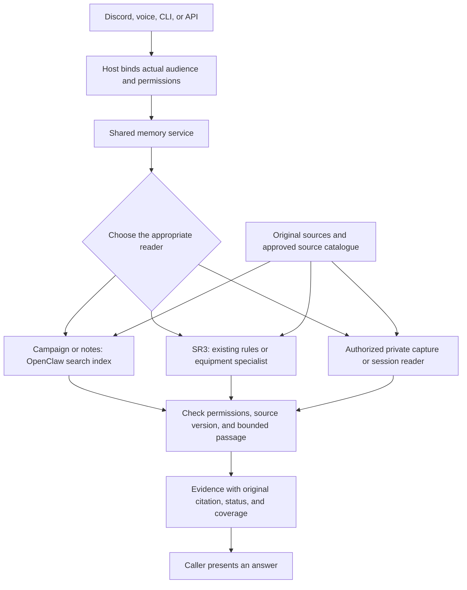
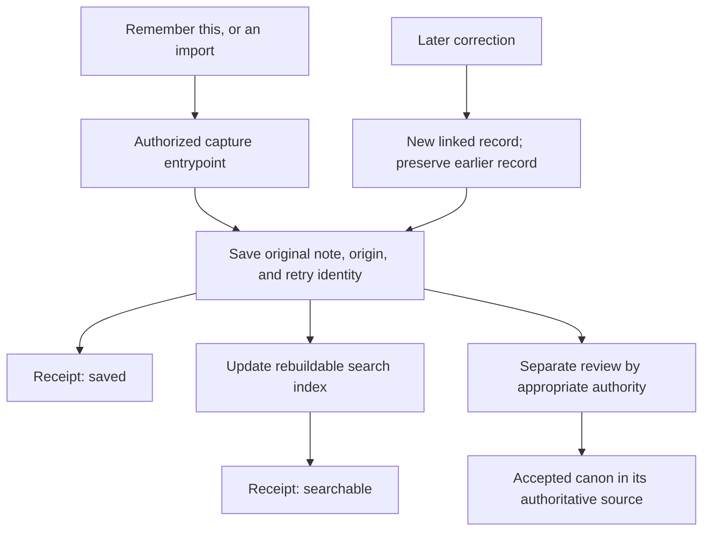

# ELI10: follow a question and a new fact

[Start here](START-HERE.md) · [Simpler explanation: ELI5](ELI5.md)

**November 4, 2026. Diagrams show the target, not completed production wiring.**

## 1. What are we unifying?

Today, campaign search, OpenClaw memory, saved facts, and specialist rule lookups
have different entrypoints and responsibilities. This creates opportunities for
disconnected writes, inconsistent answers, unclear authority, and duplicated
evidence. The proposal is a common **access/write contract**: shared rules for
requests, permissions, citations, failures, and save receipts.

It is not a new external database or a complete search rewrite. OpenClaw's
keyword-and-meaning search is reused. Exact SR3 page/equipment
specialists remain distinct because precision and edition-specific citations
matter more than forcing everything into one ranking.

## 2. Where does truth live?

- **Campaign canon:** the campaign wiki, with provisional/draft material labeled.
- **SR3 rules:** original SR3 sources; specialist lookups retain their citations.
- **Private operations:** private workspace notes, not public campaign answers.
- **Conversation evidence:** original conversations, through host-authorized
  session access—not raw transcript/database shortcuts.
- **New captures:** durable private, provisional records with their origin.

Summaries and dossiers are views, not extra witnesses. Copies remain connected
to their underlying evidence. Corrections preserve earlier records.
See [ownership rules](PLAN.md#goal-and-invariants).

## 3. Read path: answering a question

The source catalogue lists eligible sections, versions, visibility, and authority.
Unknown visibility defaults private. Searches and direct reads must enforce
permissions before snippets leave the service; checking only the final answer
would be too late. A requester cannot grant access by sending an audience label.

The index is a **rebuildable finding aid**. Citations point to original sections,
not disposable index copies. A ranking score is not proof that a claim is true.
“No matching evidence” must differ from “search is unavailable” and “this source
changed.” Otherwise a broken reader can masquerade as a confident negative.

Implementation anchors: [shared service](../../unification/service.py),
[policy](../../unification/policy.py), [source catalogue](../../unification/registry.py),
[specialists](../../unification/specialists.py), [public adapter limits](ADAPTER-DESIGN.md).

## 4. Write path: remembering without inventing canon

**Saved, searchable, and confirmed are different states.** A failed indexing step
must not pretend the note is searchable. Retrying the same submission must not
duplicate it. Capturing a claim cannot make it public or confirmed. Moving accepted
facts into canon is a separate reviewed action, not an implemented automatic
promotion pipeline. See [capture code](../../unification/capture.py) and
[durability/import evidence](CAPTURE-AND-ROLLOUT.md).

## 5. What works, and what remains?

**Built/staged:** the service, catalogue/policy checks, specialist wrappers,
public-only native search adapter, and private capture component. A controlled
pilot imported 17 records, retrieved them, and repeated the import without
duplicates. These are bounded demonstrations, not full-system acceptance.

**Historical live pilot:** a separate optional public tool was deployed for two
approved sections. It did not replace ordinary memory routes. This guide does
not freshly verify that deployment's liveness. [Deployment record](U4-TOOL-CANARY.md).

**Unfinished:** broad host-authorized/private-session integration; real worker
containment, identity, cancellation and write-lifetime guarantees; full-source
quality and preservation checks; consistent caller/writer cutovers; recovery;
voice and live-table acceptance; retirement of redundant routes.

The difficult worker issue is concrete: a search helper may update internal
indexes. Cancelling the reply does not undo a completed write or prove background
work stopped. The host must deny new unauthorized work, account for already
admitted effects, and retain control until real resources finish. Simulated
protections and the [latest source-only plan](U4-UPSTREAM-OWNERSHIP-SEAM-PLAN.md)
are not that completed connection.

## 6. Questions for the human architecture review

- Are these the right owners of truth, especially captures versus wiki canon?
- Is reusing a version-pinned internal OpenClaw interface worth its upgrade cost?
- Can the first useful release stay public-only while private integration waits?
- Is section-level classification manageable, or should mixed documents be split?
- Which real questions and missing facts would convince us retrieval improved?
- What minimal end-to-end demonstration should precede any further rollout?

Shared rules improve consistency, but the common boundary becomes critical
infrastructure. Fail-closed behavior protects privacy by sometimes refusing an
answer. Review that design before treating test counts as readiness.
