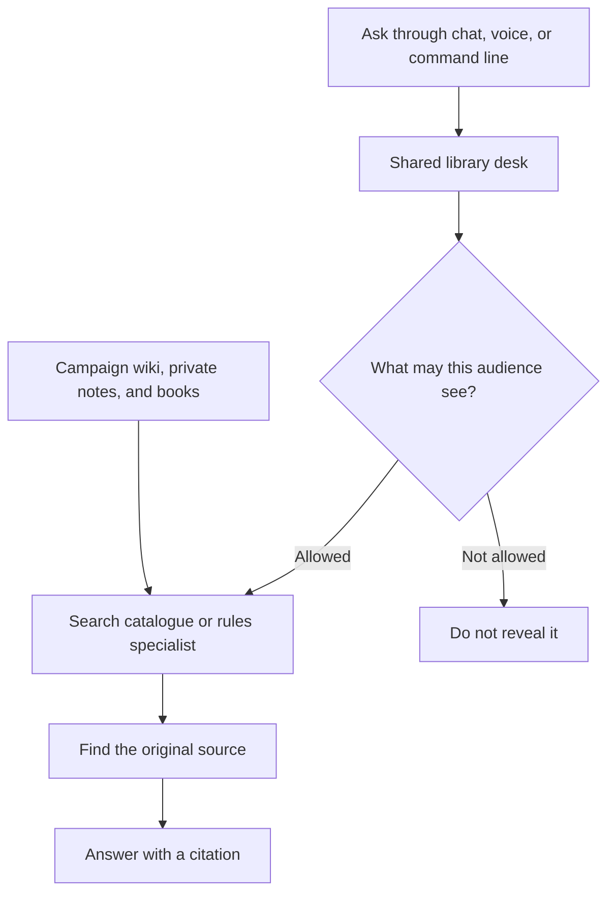

# ELI5: one library desk

[Start here](START-HERE.md) · [More detail: ELI10](ELI10.md)

## Why change anything?

Imagine Cindy has several librarians. One searches campaign notes, another
remembers conversations, another finds game rules. They do not all use the same
catalogue or saving process. Something one remembers might be hard for another
to find. Repeated summaries can also make one shaky story look well supported.

The plan is **one shared front desk**, not putting every book into one giant book.
The desk asks the right specialist, follows the same privacy rules, and tells us
where its answer came from.

## The intended library — not all connected yet

The wiki remains the campaign's official notebook. SR3 books remain the rules
authority. Private notes stay private. Conversations are evidence, not automatic
campaign truth. Search catalogues help locate these sources; they can be rebuilt
without throwing away the originals.

The desk checks privacy **before showing a passage**, even if someone asks for
its exact address. A public question does not get private powers just because
the person operating Cindy has them.

## What happens when we say “remember this”?

The desk should put the new note somewhere durable and record who said it.
Three different promises must stay separate:

- **Saved:** the note is safely stored.
- **Searchable:** the search tool can find it.
- **Confirmed:** the appropriate authority accepted it as true.

Saving does not confirm. New captures start private and unconfirmed. Corrections
keep the old note and show what changed. Three summaries copied from one story
still count as **one story**, not three witnesses.

## What actually exists?

**Built/piloted:** a shared-service component, privacy checks, a small public
search connection, and capture code. A controlled import saved and retrieved 17
private records; retrying added no duplicates. A separate optional public tool
was historically deployed for just two approved sections.

**Not finished:** joining the real chat/voice callers and workers safely, proving
the full collection answers well, and completing recovery and live-game trials.
We cannot call this a working replacement yet.

One tricky part: telling a helper “stop” does not prove it has stopped writing.
The real connection must account for that before it releases control.

Evidence: [overall design](PLAN.md), [public search](ADAPTER-DESIGN.md),
[capture pilot](CAPTURE-AND-ROLLOUT.md), [tool pilot](U4-TOOL-CANARY.md),
[unfinished integration](U4-UPSTREAM-OWNERSHIP-SEAM-PLAN.md).
